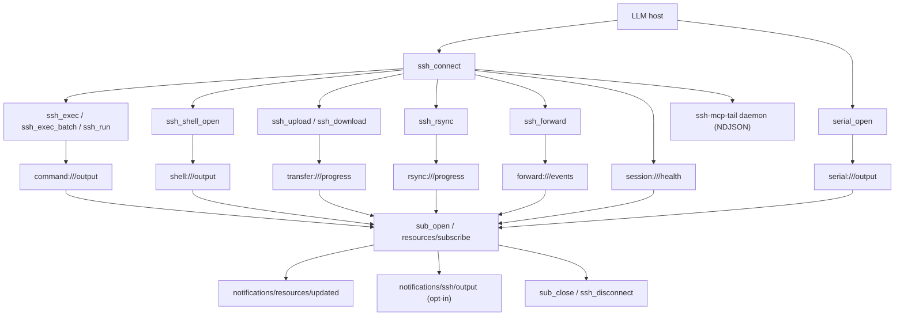

# Functional documentation

The functional contract of ssh-mcp at version 7.1.3: the actors that use it, the flows it
implements today, and the acceptance criteria the repository proves with committed tests.
Every statement carries the file and line that shows it. Behaviour the code contradicts is
recorded as a known limitation inside the flow it belongs to.

## Overview

ssh-mcp is a subscribe-first Model Context Protocol server (`README.md:3`). It lets any
MCP-capable host open SSH sessions, run asynchronous commands, drive interactive PTYs,
transfer files over SFTP, mirror directory trees with rsync, bind local TCP port forwards,
and talk to local serial ports (`README.md:30`).

| Fact | Value | Source |
| --- | --- | --- |
| Version | 7.1.3, edition 2024, MSRV 1.99 | `Cargo.toml:14-16` |
| Binaries | `ssh-mcp` (HTTP, default bind port 8000 at path `/`), `ssh-mcp-stdio` (stdio), `ssh-mcp-tail` (NDJSON daemon) | `README.md:76-78` |
| Tool catalogue | 39 tools with the `port_forward` feature, 38 without; `ssh_*` 24, `sub_*` 9, `serial_*` 6 | `README.md:82-88`, `docs/API.md:63` |
| Push resource schemes | 7: `shell://`, `command://`, `transfer://`, `session://`, `forward://`, `serial://`, `rsync://` | `docs/RESOURCES.md:20-30` |
| Response envelope | block markdown body plus a `structured_content` JSON twin | `docs/API.md:51`, `docs/CONFIGURATION.md:47` |
| Error taxonomy | 56 codes with declared retry semantics | `docs/OPERATIONS.md:3` |
| MCP protocol version | `2025-06-18` | `docs/RESOURCES.md:13` |
| Configuration chain | per-call parameter, then environment variable, then built-in default | `docs/CONFIGURATION.md:9-25` |

The public surface is the MCP tool catalogue, the block-markdown response envelope, and the
error taxonomy (`REVIEW_CHECKLIST.md:27-31`). Tunables resolve through the parameter,
environment, default chain, and an unparsable environment value falls through to the default
(`docs/CONFIGURATION.md:23-25`).

## Actors

| Actor | What it is | What it does | Source |
| --- | --- | --- | --- |
| LLM host | the MCP client that calls the tools | opens sessions, runs commands, subscribes to push lanes, drains events, closes resources | `README.md:28`, `docs/LLM_GUIDE.md:377-408` |
| Operator | the person who deploys and configures the server | installs the binaries, sets environment variables, runs the incident procedures | `docs/OPERATIONS.md:3`, `Makefile:121-135` |
| Remote SSH host | the OpenSSH-compatible server reached over the network | serves exec channels, PTY sessions, the SFTP subsystem, and `rsync --server` | `README.md:65-67` |
| Local serial device | a UART / TTY / COM port on the server host | carries the byte stream the `serial_*` tools drive, with no SSH involved | `README.md:68`, `docs/API.md:880` |
| MCP peer | the transport-endpoint identity derived per client | owns the subscription lanes and is swept by peer GC when its transport closes | `docs/RESOURCES.md:247-255`, `docs/OPERATIONS.md:76` |
| Agent scope | the `agent_id` grouping of sessions | groups sessions for bulk cleanup through `ssh_disconnect_agent` | `docs/API.md:90`, `docs/API.md:215` |

## Flows

### F1 — Connect and disconnect a session

`ssh_connect` opens the session, stores it, and returns `SESSION_ID`, `HOST`, `AGENT_ID`,
`PERSISTENT` and `EXPIRES_AT` (`docs/API.md:73-107`). The authentication chain tries the key,
then the password, then the agent (`docs/API.md:83`). The `reuse` policy is `suggest` (the
default, which lists candidate sessions and stops), `auto` (reuse the most recent healthy
match), or `force_new` (`docs/API.md:91`). Status values are `OK`, `REUSED`, `SUGGESTED`
(`docs/API.md:93`). A non-persistent session carries `EXPIRES_AT` at
`connected_at + SSH_INACTIVITY_TIMEOUT` (`docs/API.md:107`, `docs/CONFIGURATION.md:61`).

Disconnect removes the session and closes the lanes of the resources it owns:
`ssh_disconnect` for one session (`docs/API.md:157-159`), `ssh_disconnect_agent` for every
session under an `agent_id` (`docs/API.md:215`), `ssh_disconnect_many` for an explicit id
list (`docs/API.md:239`).

Errors: `CONNECTION_FAILED` when the handshake or all retries fail, and `AUTH_FAILED`
(`docs/API.md:151-153`).

Known limitations:

- After a disconnect the russh adapter keeps its own records of shells and of finished
  commands. `RusshAdapter::disconnect` (`src/adapters/ssh/russh_adapter.rs:682-706`) removes
  the session row, the SFTP registration, and the session's forwards, and leaves the adapter's
  `shells` and `commands` maps untouched (`:248-249`); those two maps are pruned only by
  `cancel` (`:746-747`) and `close_shell` (`:784-788`). The disconnect use case prunes the
  repository rows, force-closes the lifecycle entries, and closes the lanes
  (`src/application/disconnect_session.rs:230-244`, `:252-263`) and calls `ssh.cancel` for the
  running commands alone (`:235`), so no `close_shell` reaches the adapter for the shell rows
  it prunes. The operations document states that the child resources cascade-close before the
  session row is removed (`docs/OPERATIONS.md:222`); the lifecycle state and the lanes do, the
  adapter's records do not.
- None of the calls that create a resource enforces the documented `SSH_SHELL_INACTIVITY_TTL`
  or `SSH_COMMAND_CLEANUP_TTL` defaults. Both are configuration values with no consumer
  (`src/ports/config.rs:35`, `src/ports/config.rs:41`; the trait methods are referenced only by
  the environment and memory adapters — `src/adapters/config/env.rs:168-182`,
  `src/adapters/config/memory.rs:383-391`).

### F2 — Run a command

`ssh_exec` starts an asynchronous command and returns `STARTED` with the `COMMAND_ID`
(`docs/API.md:275-306`). Output is retrieved with `ssh_exec_output`, which returns the current
snapshot or waits for the terminal state when `wait=true` (`docs/API.md:310-350`).
`ssh_commands` lists the commands of a session (`docs/API.md:354`), and `ssh_exec_cancel`
cancels one (`docs/API.md:378`). `ssh_exec_batch` runs a list of commands with
`stop_on_failure` (`docs/API.md:450`). `ssh_run` is the one-shot fallback: it connects, runs,
drains, and disconnects in a single call (`docs/API.md:404`).

Cancellation is reachable two ways: the `ssh_exec_cancel` tool, and the native
`notifications/cancelled` routing of the rmcp SDK (`docs/OPERATIONS.md:708-736`; the manifest
requests rmcp 3.11 at `Cargo.toml:74`, and the lockfile resolves 3.11.0 at
`Cargo.lock:1994-1995`). Retries of a mutating call are deduplicated when the caller passes
`_meta.idempotency_key` (`docs/LLM_GUIDE.md:666`, `docs/CONFIGURATION.md:180`).

### F3 — Drive an interactive shell

`ssh_shell_open` allocates the PTY and returns `SHELL_ID` and an `INITIAL_BUFFER` when the
prompt arrives within 100 ms (`docs/API.md:488-525`, `docs/LLM_GUIDE.md:720`). Input goes
through `ssh_shell_write` (`docs/API.md:529`) or `ssh_shell_press` for named keys
(`docs/API.md:554`). Reading is `ssh_shell_read` with a snapshot or `wait=true`
(`docs/API.md:606`) and pattern waiting is `ssh_shell_wait_for`, bounded to 16 patterns of at
most 1024 bytes each (`docs/API.md:638-640`, `src/application/wait_for_pattern.rs:59-62`).
`ssh_shell_close` closes it (`docs/API.md:683`). Hosts without subscribe support fall back to
`ssh_shell_read wait=true` long-polling (`docs/OPERATIONS.md:684-706`).

Max shells per session is the compile-time constant 10
(`src/adapters/ssh/internal/shell.rs:154`), surfaced through the configuration port
(`src/adapters/config/env.rs:172-174`).

### F4 — Transfer a file

`ssh_upload` streams a local file to the remote host and `ssh_download` streams a remote file
to the local host; both return `STARTED` with `TRANSFER_ID` (`docs/API.md:707-824`). Both
accept `resume` and `verify` (`docs/API.md:749-750` for the upload direction, `:821-822` for
the download direction); a resumed response carries `RESUMED_FROM` with the offset the
transfer resumed from (`docs/API.md:749-750`, `docs/CONFIGURATION.md:86-95`). A destination
larger than the source fails with `RESUME_OVERSHOOT`, and a diverging verified prefix fails
with `RESUME_MISMATCH` (`docs/OPERATIONS.md:557-558`, `docs/OPERATIONS.md:571-572`).
`ssh_transfer_progress` returns the point-in-time snapshot or waits for terminal
(`docs/API.md:828-874`).

The per-session cap is the compile-time constant 10 running transfers
(`src/adapters/sftp/internal/transfer.rs:38`); terminal rows stay readable through
`ssh_transfer_progress` without holding a slot (`CHANGELOG.md:23`, `session.md:52-59`).
A breach returns `MAX_TRANSFERS_EXCEEDED` (`docs/OPERATIONS.md:554`).

### F5 — Mirror a tree with rsync

`ssh_rsync` starts a recursive sync and returns `STARTED`, `RSYNC_ID`, `TRANSPORT` and the
subscribe URI (`docs/API.md:981-1022`). `transport=auto` probes the remote and routes to the
wire client when the remote advertises rsync v3.2.0 or newer, otherwise to the SFTP fallback;
`transport=wire` forces the wire client and returns `RSYNC_VERSION_TOO_OLD` when the remote
rsync is missing or older; `transport=sftp` skips the probe (`docs/API.md:1008`,
`docs/OPERATIONS.md:594`). Options cover recursion, `--delete`, exclude and include patterns,
dry run, bandwidth limit, compression, partial transfer, checksums, and attribute
preservation (`docs/API.md:990-1007`). `ssh_rsync_cancel` cancels a live sync and is
idempotent (`docs/API.md:1028-1042`); `ssh_rsync_stats` returns the counters
(`docs/API.md:1046`). The `rsync://<RSYNC_ID>/progress` lane carries per-file events and the
`SyncCompleted` aggregate (`docs/RESOURCES.md:30`, `docs/RESOURCES.md:57-80`).

Options the SFTP path cannot serve return `SFTP_FEATURE_MISSING`
(`docs/OPERATIONS.md:605`). The per-session rsync cap is 4
(`src/adapters/config/env.rs:54-56`, `src/adapters/config/env.rs:180-182`).

### F6 — Forward a TCP port

`ssh_forward` binds a local listener and forwards to the remote side, returning `FORWARD_ID`
(`docs/API.md:1197-1224`). Lifecycle events stream on `forward://<FORWARD_ID>/events`
(`README.md:100`, `docs/RESOURCES.md:28`). The tool exists only in a build with the
`port_forward` feature, which is on by default (`Cargo.toml:145-147`, `README.md:82`); a
subscription to `forward://` on a build without the feature returns `FEATURE_DISABLED`
(`docs/OPERATIONS.md:589`). A local port already bound returns `PORT_IN_USE` and any other
bind failure returns `FORWARD_FAILED` (`docs/OPERATIONS.md:588-590`).

### F7 — Talk to a local serial port

`serial_open` opens a UART, TTY, or COM port and starts its reader and writer tasks, returning
`SERIAL_ID` and the subscribe URI (`docs/API.md:882-903`). `serial_write` sends text or
base64 bytes, `serial_press` sends named keys, `serial_scan` lists the OS-visible devices, and
`serial_active` lists the ports this process holds (`docs/API.md:912-954`). `serial_close`
cancels the tasks and releases the handle (`docs/API.md:905`). Writes go through a bounded
queue and surface `SERIAL_BACKPRESSURE` instead of stalling (`docs/API.md:880`). A full
`stty`-shaped parameter set is accepted: baud rate, data bits, stop bits, parity, flow
control, read timeout, buffer size, initial DTR and RTS (`docs/API.md:884-898`).

### F8 — Subscribe and push

`sub_open` mints a `SubId` and returns it with the canonical URI, the grace window, and
`INLINE_PUSH_HONORED` (`docs/API.md:1078-1108`). `sub_close` releases a lane
(`docs/API.md:1110`), `sub_pause` gates delivery for the lane and `sub_resume` resumes it
with one catch-up notification (`docs/API.md:1124-1142`), `sub_filter` hot-reloads the lane regex (`docs/API.md:1144`),
`sub_replay` re-emits from a cursor (`docs/API.md:1155`), and `sub_list`, `sub_stats` and
`sub_stats_all` report the lane state (`docs/API.md:1166-1191`). The legacy
`resources/subscribe` path uses the registry only and opens no lane
(`docs/RESOURCES.md:256-303`). Push arrives as `notifications/resources/updated`
(`docs/RESOURCES.md:304-323`), and an opted-in lane also receives
`notifications/ssh/output` with the raw byte tail inline (`docs/API.md:1306-1308`,
`docs/LLM_GUIDE.md:491-534`). Backpressure is handled by sequence numbers, keepalives, and
cumulative chunks (`docs/RESOURCES.md:325-342`).

Resource lifecycle states are `Owned`, `Observed`, `Releasing` and `Closed`, driven by a CAS
plus a per-session refcount cascade; the grace timer fires the `Releasing -> Closed` edge
(`README.md:32`, `src/adapters/lifecycle/grace_timer.rs:1-26`, `:148-165`). Lanes carry a
`SubId` with their own queue, lag policy, filter pipeline, replay buffer and stats
(`README.md:32`, `docs/API.md:1078`).

Known limitations, all verified in the code on 2026-11-21:

- `sub_pause` now gates delivery; measured in feature 005 on 2026-11-22. The flag is set at
  `src/adapters/subscription/subscriber_lane.rs:839` and cleared by the swap at `:849`. Both
  producer entries load it: the legacy fan-out at
  `src/adapters/subscription/lane_bridge.rs:289` and the inline-only entry at `:303`; the
  dispatch preparation skips a paused lane at `:269`, and a dispatch already dequeued is
  dropped at `:483`. Inline payloads are still composed, so `seq` and the byte cursor keep
  advancing while the fragments are dropped (`:285-288`), and the delivery counters do not
  advance (`record_notify`, `src/adapters/subscription/subscriber_lane.rs:271`). A resume of
  a paused lane sends exactly one catch-up `notifications/resources/updated`
  (`src/application/subscription_admin.rs:343-345`). A `resources/subscribe` subscription
  opens no lane: it is delivered by the per-peer fan-out
  (`src/adapters/subscription/memory_registry.rs:995-1000`) and there is nothing for the
  flag to gate. The pin lives in
  `crate::application::subscribe_resource::tests::resources_subscribe_records_no_lane_and_delivers_once`.
  The cure the operations document prescribes for a lane that delivers nothing, "Lane
  paused — call `sub_resume`" (`docs/OPERATIONS.md:79`, `:103`), therefore works for a lane
  opened by `sub_open`.
- The lane lifetime (`auto_close`, `lease`) is stored and never enforced. It is copied into
  the lane state at `src/adapters/subscription/subscriber_lane.rs:246` and read back only for
  the summary at `:298`; `sub_open` reports `GRACE_MS` from it
  (`src/application/subscription_admin.rs:158`) and no timer or lease check consumes it.
- `sub_replay` answers `OK` and delivers nothing on the HTTP and stdio compositions. It
  pushes a `Snapshot` into the per-lane queue at
  `src/adapters/subscription/subscriber_lane.rs:855-882`; that queue is drained by the channel
  mux, whose outbound receiver is dropped at composition time
  (`src/composition/prod.rs:344`). Delivery to peers on those transports runs through the
  lane bridge, which the replay path does not touch.
- `sub_open` refuses a missing `shell`, `command`, `transfer` or `session` id with the
  per-kind `*_NOT_FOUND` code before any lane is opened: the guard call is
  `src/application/subscription_admin.rs:150`, the single kind table is
  `src/application/subscribe_resource.rs:170-189`, and the guard lives in
  `src/application/resource_guard.rs`. A refused call takes no lane slot, leaves no stats
  row and starts no debouncer. `forward`, `serial` and `rsync` stay permissive. The
  description still lists `RESOURCE_NOT_FOUND` (`src/infra/mcp/tool_router.rs:2389`, the
  `description = "Open a Channel Mux lane …"` line), a code no path emits.
- On the HTTP transport, a second session replaces the producer forwarder of the first.
  `build_use_cases` (`src/composition/prod.rs:227`) runs once per server instance and ends by
  installing its own registry as the single producer forwarder of the process-wide legacy
  registry (`src/composition/prod.rs:544`), and `install_forwarder` replaces whatever was
  installed before (`src/adapters/subscription/legacy.rs:193-195`; the only caller in the tree
  is that composition site). The HTTP service builds each server through a factory
  (`src/composition/prod.rs:750-756`), and the composition comment states that the factory runs
  once per session (`src/composition/prod.rs:798-802`). Under that premise — a statement of the
  code comment, not behaviour this repository tests — the lanes of an earlier HTTP session stop
  receiving producer events once a later session installs its forwarder, except through the
  periodic flush, and `inline_events_sent` stops advancing for the older session. The
  procedures the repository supports today are to reconnect the affected host, or to consume
  the events on a transport with one composition per process: the stdio binary or the
  `ssh-mcp-tail` daemon (`README.md:120-129`).
- `release_when_no_subs=true` moves the lifecycle state to `Closed` after the grace window and
  leaves the resource running. The close commits the state and the cascade decrement
  (`src/adapters/lifecycle/grace_timer.rs:148-165`) without closing the shell, the command, or
  the transfer it released.

### F9 — NDJSON daemon

`ssh-mcp-tail` exposes `run` (one-shot connect and exec), `shell` (interactive PTY), and
`daemon` (multi-session command and event loop) (`docs/DAEMON.md:56-64`). The daemon reads 13
operations from stdin, one JSON object per line (`docs/DAEMON.md:84-86`), and writes one NDJSON
event per line on stdout: `ack`, `err`, `started`, `push`, `completed`, `transfer_progress`,
`shell_output`, `snapshot`, `lagged`, `warn`, `closed`, `resource_closed`, `inline_push`,
`heartbeat`, `daemon_stats` (`docs/DAEMON.md:286-430`). `warn` carries advisory codes such as
`SUB_LEAK_RISK` (`docs/DAEMON.md:375-380`). The daemon embeds the MCP client and server over an
in-process duplex transport with no IPC syscall (`docs/DAEMON.md:52`). Rsync runs through the
embedded MCP client surface and the existing `subscribe` operation, not through new daemon
operations (`docs/DAEMON.md:88`).

## Acceptance Criteria

Each flow names the committed test that proves it. Every row states what the body of the named
test asserts, checked against the code on 2026-11-21; a criterion whose proof is gated, absent,
or weaker than the criterion is marked unproven or qualified.

| Flow | Criterion | Proof | State |
| --- | --- | --- | --- |
| F1 | connect, list, and disconnect round-trip in one host session | `scripts/test_http.py::test_connect_disconnect_roundtrip` | proven |
| F1 | `reuse=auto` reuses a healthy session of the same identity and opens no new connection | `src/application/connect_session.rs::identity_match_with_auto_and_healthy_yields_reused` | proven |
| F1 | an unreachable host returns `CONNECTION_FAILED` | `scripts/test_v5_adversarial.py::test_connect_unreachable_host_returns_connection_failed` | proven |
| F1 | a dead explicit `session_id` is purged, then a fresh connect runs | `src/application/connect_session.rs::explicit_session_id_when_dead_falls_through_to_fresh_connect` | proven |
| F2 | an asynchronous command is polled to `COMPLETED` and listed | `scripts/test_http.py::test_execute_polling_and_list_commands` | proven |
| F2 | `ssh_exec_output wait=true` returns `COMPLETED` with the exit code and stdout | `scripts/test_http.py::test_execute_and_get_output_wait` | proven |
| F2 | cancelling a running command answers `CANCELLED` or `NOOP` | `scripts/test_http.py::test_cancel_running_command` | proven |
| F2 | a batch with `stop_on_failure` halts at the failing command and skips the rest | `scripts/test_v47_batches.py::test_batch_stop_on_failure_halts_after_first_error` | proven |
| F2 | one idempotency key replays the same body and `command_id`, and one command row exists | `scripts/test_v47_idempotency.py::test_same_key_dedups_ssh_execute` | proven |
| F3 | PTY open, write, read, and close round-trip on the wire | `scripts/test_http.py::test_shell_open_write_read_close` | proven |
| F3 | `ctrl_c` leaves the shell responsive after a running `cat` | `scripts/test_send_key.py::test_ctrl_c_breaks_cat` | proven |
| F3 | `ssh_shell_wait_for` answers `MATCHED` with the first matching pattern | `scripts/test_wait_for.py::test_wait_for_matched_pattern_in_heredoc` | proven |
| F3 | `INITIAL_BUFFER` carries a fast banner on the markdown and structured channels | `scripts/test_v47_initial_buffer.py::test_initial_buffer_emitted_when_banner_arrives_fast` | proven |
| F3 | a write reports the byte count and forwards the bytes to the SSH port | `src/application/write_shell.rs::happy_path_returns_bytes_written_and_records_write_call` | proven |
| F4 | a partial destination resumes at its size: 4 MiB present of an 8 MiB source | `tests/v6_resume_smoke.rs::upload_resume_partial_destination_carries_offset` | proven |
| F4 | a tagged `[RESUME_MISMATCH]` SFTP error propagates to the caller unchanged | `tests/v6_resume_smoke.rs::download_resume_verify_mismatch_propagates_tagged_sftp_error` | proven |
| F4 | equal sizes yield the `Skip` plan with the size as total | `tests/property_resume.rs::prop_upload_skip_iff_equal` | proven |
| F4 | the plan matrix holds over both sizes: `Skip` exactly when equal, `Resume` when the destination is smaller, `[RESUME_OVERSHOOT]` when it is larger | `tests/property_resume.rs::prop_upload_decision_matrix_total` | proven |
| F4 | a polled upload reports `0 < bytes_transferred < total` mid-flight; the test skips when the fixture finishes inside one poll interval | `scripts/test_transfer_progress.py::test_upload_progress_reports_live_partial_bytes` | proven with a skip path |
| F4 | twelve sequential uploads on one session each reach `COMPLETED` | `scripts/test_http.py::test_more_than_ten_sequential_uploads_on_one_session` | proven |
| F5 | the SFTP transport mirrors a three-file tree byte-identical against the local sshd | `scripts/test_v7_rsync_http.py::test_rsync_sftp_transport_against_local_sshd` | proven |
| F5 | a forced wire transport against the local fixture answers `STARTED` or a categorical wire error, and the test does not assert a transfer | `scripts/test_v7_rsync_http.py::test_rsync_wire_transport_against_local_sshd` | proven for the error path only |
| F5 | `transport=auto` picks the wire client when the probe reports rsync v31, and never opens SFTP | `tests/v7_rsync_smoke.rs::transport_auto_routes_to_wire_when_rsync_v31_present` | proven |
| F5 | `preserve.perms` against a `setstat`-refusing SFTP fixture returns `SFTP_FEATURE_MISSING` without opening the transport | `tests/v7_rsync_smoke.rs::sftp_with_perms_against_unsupported_server_returns_feature_missing` | proven |
| F5 | wire and SFTP are byte-identical against rsync 3.2.7 on a VM | `tests/v7_rsync_wire_e2e_vm.rs` | unproven (gated `e2e-vm`, `CI.md:58-66`) |
| F6 | a local listener is bound for the session and reports active | `scripts/test_http.py::test_forward_local_to_remote` | proven |
| F6 | a bound local port returns `PORT_IN_USE` carrying the port | `src/application/forward_port.rs::local_port_already_bound_returns_port_in_use` | proven |
| F7 | the serial config constructor defaults to 8N1 with no flow control | `src/adapters/serial/state.rs::config_new_sets_8n1_defaults` | proven |
| F7 | the parity parser accepts the short and long forms and rejects an unknown one | `src/adapters/serial/state.rs::parity_parser_accepts_short_and_long_forms` | proven |
| F7 | an unknown (peer, URI) serial cursor reads zero | `src/adapters/serial/state.rs::peer_cursor_defaults_to_zero_for_unknown_pair` | proven |
| F7 | the serial peer cursor only advances forward | `src/adapters/serial/state.rs::advance_peer_cursor_is_monotonic_max` | proven |
| F7 | clearing cursors drops only the matching URI | `src/adapters/serial/state.rs::clear_peer_cursors_for_only_drops_matching_uri` | proven |
| F7 | open, write, read, and close against a real UART round-trip | no committed test drives a device; the only serial tests are the state-layer ones cited above (`src/adapters/serial/state.rs:714`) | unproven |
| F8 | a shell lane with `cursor=auto` delivers only fresh bytes, repeats none, and keeps the cursor monotonic | `scripts/test_v47_subscriptions.py::test_s01_shell_subscribe_cursor_auto_delivers_fresh_bytes` | proven |
| F8 | unsubscribe stops notifications on that URI | `scripts/test_v47_subscriptions.py::test_s08_unsubscribe_stops_notifications` | proven |
| F8 | a second unsubscribe raises no hard error; the test skips when the server reports `RESOURCE_NOT_FOUND` or `NOT_SUBSCRIBED` | `scripts/test_v47_subscriptions.py::test_s09_unsubscribe_is_idempotent` | proven with a skip path |
| F8 | the keepalive fires on an idle lane with `SSH_NOTIFY_KEEPALIVE_S=2` | `scripts/test_v47_subscriptions.py::test_s15_keepalive_fires_after_idle` | proven |
| F8 | the four resource-creating tools advertise `release_when_no_subs` and `grace_ms` in their input schema | `tests/v5_smoke.rs::t06_release_when_no_subs_grace` | proven (schema advertisement only; the same test asserts nothing about a release) |
| F8 | the grace timer drives `Releasing` to `Closed` after the deadline, and does not fire before it | `src/adapters/lifecycle/grace_timer.rs::timer_fires_close_when_deadline_elapsed_before_run`, `::poll_cadence_does_not_fire_before_deadline` | proven (the state transition only; see the teardown row below) |
| F8 | a re-subscribe inside the grace window returns the resource to `Observed` | `tests/property.rs::prop_grace_timer_cancel_correct` | proven |
| F8 | a grace fire racing a re-subscribe resolves to one outcome: `Closed`, or a typed `ResourceGone` | `tests/chaos.rs::chaos24_grace_vs_resubscribe_resolves_to_single_outcome` | proven |
| F8 | the released resource itself is torn down when the grace window expires: the shell, command, or transfer is closed | none — the timer commits state and refcount and closes nothing (`src/adapters/lifecycle/grace_timer.rs:148-165`) | unproven |
| F8 | a resource with `release_when_no_subs=false` and no subscriber raises a `Warn` alert, and one with it true does not | `tests/v5_smoke.rs::t09_sub_leak_risk_warn` | proven |
| F8 | `sub_pause` and `sub_resume` report the toggled state through the lane admin | `src/application/subscription_admin.rs::pause_resume_round_trip` | proven |
| F8 | a paused lane receives no delivery until resume | `src/adapters/subscription/lane_bridge.rs::paused_lane_receives_no_delivery_until_resume` | proven |
| F8 | pause gates one lane and not another lane on the same URI | `src/adapters/subscription/lane_bridge.rs::pause_does_not_gate_another_lane_on_the_same_uri` | proven |
| F8 | `seq` and the cursor stay monotonic across the pause | `src/adapters/subscription/lane_bridge.rs::paused_inline_lane_keeps_cursor_and_seq_monotonic_across_the_gap` | proven |
| F8 | delivery counters do not advance while paused | `src/adapters/subscription/lane_bridge.rs::paused_lane_counters_do_not_advance` | proven |
| F8 | resume of a paused lane notifies exactly once and resume of a running lane does not | `src/application/subscription_admin.rs::resume_of_a_paused_lane_notifies_once_with_its_sub_id`, `src/application/subscription_admin.rs::resume_of_a_running_lane_does_not_notify` | proven |
| F8 | `resources/subscribe` opens no lane and its peer is delivered by the fan-out | `src/application/subscribe_resource.rs::resources_subscribe_records_no_lane_and_delivers_once` | proven |
| F8 | a `sub_open` of a missing repository-backed resource is refused with the per-kind code and opens no lane | `src/application/subscription_admin.rs::subscribe_unknown_shell_is_refused`, `::refused_sub_open_leaves_no_lane_and_no_debouncer` | proven |
| F8 | an opted-in lane receives one inline fragment carrying the producer bytes unchanged | `tests/v5_smoke.rs::t_inline_push_full_handshake_to_byte_delivery` | proven |
| F9 | the daemon answers a connect operation with an `Ack` or `Err` carrying the correlation id | `tests/v5_daemon_smoke.rs::t01_daemon_connect_exec_subscribe_drain` | proven (the test does not exercise exec, subscribe, or drain) |
| F9 | cancelling the shutdown token and calling shutdown completes without hanging | `tests/v5_daemon_smoke.rs::t02_daemon_signal_shutdown` | proven (the body asserts nothing; a hang fails it) |
| F9 | a full event channel rejects a send without blocking and accepts it again after a drain | `tests/v5_daemon_smoke.rs::t05_daemon_buffer_pressure_does_not_deadlock` | proven (a channel-level test, not a daemon-level one) |

## Observability

The server reports state through four surfaces.

- Structured logs on `tracing`, filtered by `RUST_LOG`. The documented targets are
  `ssh_mcp=debug` for use-case dispatch, `ssh_mcp::adapters::lifecycle=trace` for the
  lifecycle CAS edges, `ssh_mcp::adapters::subscription=trace` for lane behaviour, and
  `ssh_mcp::adapters::ssh::internal::client=debug` for the handshake (`docs/OPERATIONS.md:842-858`).
- Per-lane counters through `sub_stats`, rendered as `EVENTS_SENT`, `BYTES_SENT`,
  `LAGGED_DROPS`, `LAGGED_RECOVERIES`, `QUEUE_DEPTH`, `QUEUE_HIGH_WATERMARK` and
  `BLOCK_TOTAL_MS` (`src/infra/mcp/render/subscription.rs:415-436`). `events_sent` counts
  delivered `notifications/resources/updated` notifications and `lagged_recoveries` counts
  `sub_replay` calls; `lagged_drops`, `queue_depth`, `queue_high_watermark` and
  `block_total_ms` read zero for the life of a production process, and `bytes_sent` advances
  with a zero byte count, because the production notify entry passes an empty slice
  (`src/adapters/subscription/lane_bridge.rs:497-510`) into `record_notify`, which adds the
  slice length (`:339`, `src/adapters/subscription/subscriber_lane.rs:271-273`).
- Global counters through `sub_stats_all`, rendered as `LANES_TOTAL`, `EVENTS_SENT_TOTAL`,
  `BYTES_SENT_TOTAL`, `LAGGED_DROPS_TOTAL`, `LAGGED_RECOVERIES_TOTAL` and
  `QUEUE_HIGH_WATERMARK_MAX` (`src/infra/mcp/render/subscription.rs:491-507`). The operations
  document advertises a different set of names for the same tool — `active_sessions`,
  `active_subs`, `mux_queue_depth`, `peer_gc_pace_per_min`, `rejected_ops_total`,
  `rejected_ops_by_code` (`docs/OPERATIONS.md:860-869`) — and carries drift; the render is the
  source of truth.
- Advisory warnings: `WARN: SUB_LEAK_RISK` lines attach to list responses for a resource that
  stays owned past `SSH_SUB_LEAK_RISK_WARN_S` (default 2 s)
  (`src/adapters/lifecycle/leak_watcher.rs:60-131`, `docs/CONFIGURATION.md:155`). The optional
  hard-kill threshold `SSH_SUB_LEAK_RISK_KILL_S` defaults to 0, which disables it
  (`docs/CONFIGURATION.md:156`).
- The NDJSON daemon emits `heartbeat` and `daemon_stats` events on their own intervals
  (`docs/DAEMON.md:422-435`), plus `warn` events carrying the advisory codes
  (`docs/DAEMON.md:375-380`). The `daemon_stats` event carries `active_sessions`,
  `active_subs`, `ring_buffer_overflows_total` and `mpsc_full_events_total` fixed at zero
  (`src/embed/event_mux.rs:183-188`); the live global values come from `sub_stats_all`.

Operational diagnosis uses the NDJSON filters for daemon stdout and `mcp-inspector` for the
server-versus-host comparison (`docs/OPERATIONS.md:886-913`). Every binary honours `RUST_LOG`
(`docs/OPERATIONS.md:844`). The operations document also offers `tokio-console` for hung tasks
(`docs/OPERATIONS.md:915-917`); the manifest declares no console feature
(`Cargo.toml:145-149`) and no console subscriber is installed in any binary, so that tooling
does not exist in this project.

Known limitations:

- The `SSH_SHELL_INACTIVITY_TTL` and `SSH_COMMAND_CLEANUP_TTL` values an operator sets are not
  consumed by any code path, so no shell or command row is reclaimed by them
  (`src/ports/config.rs:35`, `src/ports/config.rs:41`).
- `bytes_sent` is not a delivery signal on a production process; `events_sent` is
  (`src/adapters/subscription/lane_bridge.rs:339`, `:497-510`). For a lane that opted into
  inline push, the additional signal is `inline_events_sent`
  (`src/adapters/subscription/subscriber_lane.rs:188`).
