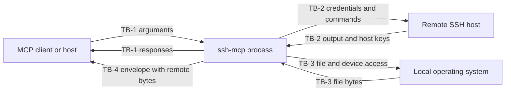

# ssh-mcp STRIDE threat model

This document is the STRIDE threat model of the ssh-mcp server, version 7.1.3
(`Cargo.toml:13-16`). It states the assets the process holds, the entry points
that reach it, the trust boundaries that separate them, and one `TM-NNN` entry
per threat with its mitigation or its open risk. Every threat cites the
repository file and line that shows the behaviour, so a reader can check the
claim against the code.

## Scope and method

The analysis covers the three binaries in the package: the HTTP transport
`ssh-mcp` (`src/main.rs:17-20`), the stdio transport `ssh-mcp-stdio`
(`src/bin/ssh_mcp_stdio.rs:17-20`), and the NDJSON daemon `ssh-mcp-tail`
(`src/bin/ssh_mcp_tail.rs:44-45`). It covers the 39 MCP tools they publish
(`README.md:80`) and the seven outbound capabilities those tools drive: SSH
sessions, command execution, PTY shells, SFTP transfers, rsync sync, port
forwarding and local serial ports (`README.md:84-88`).

The method is STRIDE over the data-flow boundaries below. A threat is written
as **Mitigated** when the repository carries a control that stops it,
**Partly mitigated** when the control narrows but does not close it, and
**Open** when the code carries no control at all. An open threat is a finding,
not a gap in the analysis: the mitigation column then names what the operator
must supply instead.

Measurements are taken from the tree at version 7.1.3, on 2026-11-21. Two facts
that the analysis leans on are environmental rather than code-level, and both
are recorded with their date: the `cargo audit` result on the current
`Cargo.lock` (TM-021), and the fact that `Cargo.lock` is not committed
(`.gitignore:4`).

## Assets

| Asset | Where it lives | What it is |
| --- | --- | --- |
| SSH credentials | process memory | Password strings, PEM key material and passphrases held in `Credentials` (`src/domain/identity.rs:91-117`) |
| SSH sessions | process memory | Live russh handles, PTY shells, async command channels and ports |
| Remote output | process memory, then tool responses | Command stdout/stderr, shell bytes, serial bytes, transfer and rsync progress |
| Local filesystem access | process privileges | Reads for `ssh_upload`, writes for `ssh_download`, device files for `serial_open` |
| The `known_hosts` trust store | `~/.ssh/known_hosts` by default | The host-key records that decide whether a server is trusted (`src/adapters/config/internal/mod.rs:459-469`) |
| Tool responses | memory, then the MCP transport | The block-markdown body plus its JSON twin, including the idempotency cache copy |

## Entry points

| Entry point | Default exposure | Evidence |
| --- | --- | --- |
| HTTP transport `ssh-mcp` | Binds `0.0.0.0:8000`, path `/`, no authentication layer | `src/composition/prod.rs:114-116`, `src/composition/prod.rs:740-748`, `src/composition/prod.rs:779-786` |
| HTTP in the macOS service definition | Wildcard bind on port 45642, `KeepAlive` on | `com.farchanjo.ssh-mcp.plist:13-19`, `com.farchanjo.ssh-mcp.plist:24-25` |
| HTTP in the container image | Port 8000 exposed, process runs as the non-root user `ssh-mcp` | `Dockerfile:28-29`, `Dockerfile:37`, `Dockerfile:40` |
| Stdio transport `ssh-mcp-stdio` | The parent process's stdin/stdout only | `src/bin/ssh_mcp_stdio.rs:17-20` |
| NDJSON daemon `ssh-mcp-tail` | The pipeline's stdin/stdout only | `src/bin/ssh_mcp_tail.rs:44-45` |
| MCP tool arguments | Whatever the transport carries | `src/infra/mcp/args/connection.rs:120-131` |
| Outbound SSH, SFTP, rsync and serial device files | Opened on caller request | `src/infra/mcp/args/serial.rs:19-20`, `src/infra/mcp/args/forward.rs:12-23` |

The HTTP transport is the only entry point that reaches the server from a
network. Its router adds exactly one layer, `TraceLayer::new_for_http()`
(`src/composition/prod.rs:786`), and neither that call nor any other line of the
repository authenticates the caller or terminates TLS: no authentication
middleware, no token check and no TLS configuration exists in the composition
root, and the manifest declares no TLS crate. A caller that reaches the port
speaks the full tool catalogue.

The transport validates the inbound `Host` header against a loopback-only list.
The SDK field documentation says the list exists "to prevent DNS rebinding
attacks against locally running servers" and that "public deployments should
override this list with their own hostnames"; the behaviour is unchanged from
the previous SDK line and was measured on both. A request whose `Host` is
`localhost`, `127.0.0.1` or `[::1]` is served; any other value receives 403
`Forbidden: Host header is not allowed` (`src/composition/prod.rs:750-760`).

## Trust boundaries

| Boundary | What crosses it | Direction |
| --- | --- | --- |
| TB-1 MCP client to server | Tool arguments, including credentials; tool responses, including remote output | Bidirectional |
| TB-2 Server to remote SSH host | Credentials, commands, file bytes; host keys, command output, remote file names | Bidirectional |
| TB-3 Server to local operating system | Local file reads and writes, device files, listener sockets | Bidirectional |
| TB-4 Response envelope to the model | Remote bytes rendered inside a `--- name [nonce] ---` block | Server to client |

TB-4 is a boundary because the reader on the far side is a language model that
acts on what it reads: bytes produced by a remote host reach the same context as
the server's own status lines.

## Spoofing

### TM-001: An unauthenticated caller reaches the whole tool catalogue

**Category:** Spoofing

**Description:** The HTTP transport binds the wildcard address by default
(`src/composition/prod.rs:114`, `src/composition/prod.rs:788`) and the router
adds no authentication layer, only `TraceLayer` (`src/composition/prod.rs:786`).
Any client that can reach the port is treated as the operator. The caller then
supplies its own SSH credentials per call
(`src/infra/mcp/args/connection.rs:123-131`), so it does not need to steal the
operator's — it uses the server as an SSH client from the server host's network
position, and reaches the local resources the tools expose.

**Impact:** Use of the host as a launch point into every network the host can
reach, plus local file read (`ssh_upload local_path`) and local listener binding
(`ssh_forward local_port`).

**Mitigations:**

- The transport is selectable: the stdio binary binds no port at all
  (`src/bin/ssh_mcp_stdio.rs:17-20`), and the operator can move the HTTP
  listener to a loopback or management address through `MCP_HOST`
  (`src/composition/prod.rs:741`), documented at `docs/CONFIGURATION.md:207`.
- The container image runs the process as the non-root user `ssh-mcp`
  (`Dockerfile:28-29`), which bounds what a rogue caller reaches through TB-3.

**Open risk:** The default is the exposure. Nothing in the repository filters,
authenticates or rate-limits the caller, and the shipped macOS service definition
inherits the wildcard bind on port 45642 (`com.farchanjo.ssh-mcp.plist:13-19`).
Closing TM-001 is a deployment decision: loopback bind, a firewall, a reverse
proxy that authenticates, or the stdio transport.

### TM-002: A rogue SSH server impersonates the target host

**Category:** Spoofing

**Description:** Every session authenticates the client to the server, never the
server to the client. Without a host-key check, a host that answers in the
target's place receives the password or the key material and every command.

**Impact:** Full credential capture and command interception on the first
connection to a host, and on every connection while verification is disabled.

**Mitigations:**

- Host keys are verified against a `known_hosts` file with trust-on-first-use
  semantics (`src/adapters/ssh/internal/session.rs:61-88`). A recorded key that
  differs is rejected and logged as a possible MITM
  (`src/adapters/ssh/internal/session.rs:71-86`).
- The insecure path is opt-in and warns on every check: verification is skipped
  only when `SSH_MCP_INSECURE_SKIP_HOST_KEY_CHECK` is set to a truthy value
  (`src/adapters/config/internal/mod.rs:447-450`), and each skip logs
  `host-key verification disabled — MITM exposure`
  (`src/adapters/ssh/internal/session.rs:126-129`).
- Three unit tests pin the three outcomes: skip accepts
  (`src/adapters/ssh/internal/session.rs:154-165`), a mismatch is rejected
  (`src/adapters/ssh/internal/session.rs:167-188`), an unknown host is learned
  (`src/adapters/ssh/internal/session.rs:190-206`).

**Open risk:** TOFU accepts an unknown host and records its key
(`src/adapters/ssh/internal/session.rs:91-116`), so the first connection to a
host is unauthenticated by construction. Two operational consequences follow.
First, the `known_hosts` path defaults to the operator's personal file
(`src/adapters/config/internal/mod.rs:463-468`), so a first contact can be
decided by a trust store the operator did not curate for this server; pinning a
server-specific file through `SSH_MCP_KNOWN_HOSTS` is the operator's move.
Second, neither knob is documented outside the module table
(`src/adapters/config/internal/mod.rs:22-23`): `docs/CONFIGURATION.md` and
`README.md` do not name `SSH_MCP_KNOWN_HOSTS` or
`SSH_MCP_INSECURE_SKIP_HOST_KEY_CHECK` anywhere.

### TM-003: Remote output forges lines in the response envelope

**Category:** Spoofing

**Description:** Remote bytes are placed inside a response whose other lines are
server-owned `KEY: value` pairs and `NEXT:` guidance. A remote host that emits
`--- stdout [deadbeef] ---` or a fake `STATUS:` line attempts to be read as the
server. The reader is a language model that acts on the text, so a forged line
is a spoofing attempt on the model's picture of the session.

**Impact:** Model-level confusion: a fabricated status, identifier or
instruction line read as authoritative.

**Mitigations:**

- Each response block is delimited by a nonce generated per response
  (`src/infra/mcp/helpers/nonce.rs:17-20`, 32 bits of entropy) and rendered as
  `--- <name> [<nonce>] ---` (`src/infra/mcp/helpers/output.rs:136-160`). Remote
  bytes cannot know the nonce before it is minted, so a forged delimiter fails
  to match. Command reads share one nonce across the stdout and stderr blocks so
  the pair stays correlatable (`src/infra/mcp/resource_handlers.rs:744-755`).
- Values that come from the remote side pass through `sanitize_value`, which
  escapes `\n`, `\r` and `\t` before the value reaches a `KEY: value` line
  (`src/infra/mcp/helpers/output.rs:92-106`); the renderers call it for remote
  paths, commands, hosts and usernames (`src/infra/mcp/render/rsync.rs:86-88`,
  `src/infra/mcp/render/sftp.rs:140-142`,
  `src/infra/mcp/render/execute.rs:230`).
- Unit tests pin the delimiter shape and the escaping
  (`src/infra/mcp/helpers/output.rs:222-248`).

**Open risk:** The serial read path returns raw device bytes with no delimiter
at all: `try_serial_read` builds a `TextResourceContents` whose text is
`String::from_utf8_lossy` of the buffer
(`src/infra/mcp/resource_handlers.rs:433-450`). A device that prints a
block-shaped line therefore reaches the model without an envelope marker. The
same is true of the JSON twin, where escaping is JSON's own. The delimiter
protects the markdown block boundary, not the model's obedience: TM-010 covers
the instruction-level variant of the same boundary.

## Tampering

### TM-004: Destructive writes happen without a confirmation step

**Category:** Tampering

**Description:** Three tool families write to a destination the caller names.
`ssh_upload` and `ssh_download` overwrite by default — the truncating plan is
the v6.0 path and resume is opt-in (`src/adapters/sftp/internal/sftp.rs:1223-1228`
for the local file, `src/adapters/sftp/internal/sftp.rs:932-938` for the remote
file, flags at `src/infra/mcp/args/sftp.rs:92` and `:136`). `ssh_rsync` carries
`opts.delete`, which removes destination paths absent from the source
(`src/infra/mcp/args/rsync.rs:122-126`). Nothing asks for confirmation, and the
caller that decides is the model.

**Impact:** Irreversible loss of local or remote data through one tool call,
with no second actor in the loop.

**Mitigations:**

- `opts.dry_run` exists and is a first-class argument
  (`src/infra/mcp/args/rsync.rs:133-138`): it emits `FileSkipped { reason:
  DryRun }` for every would-be operation without touching the destination.
- Resume is explicit, so a caller that wants to keep a partial file asks for it:
  `resume=true` plus `verify=true` hashes the resumed prefix on both sides and
  aborts with `RESUME_MISMATCH` on divergence
  (`docs/adr/0010-sftp-resume.md:30-35`).
- The rsync receiver writes through a temporary file and renames into place
  (`src/adapters/rsync/wire/receiver.rs:530-544`), so an interrupted transfer
  does not leave a half-written destination file in place.

**Open risk:** Neither `delete` nor the overwrite path has a confirmation gate,
a keep-list or a recycle step. The reviewer checklist is the only control the
repository states, and it is a human one (`REVIEW_CHECKLIST.md:55-59`).

### TM-005: A remote peer writes outside the sync destination

**Category:** Tampering

**Description:** On the rsync wire transport the file list is produced by the
peer. A list entry whose path backtracks (`..`, `../etc/passwd`, `a/../b`) would
let the peer place bytes outside the destination root the receiver was given.

**Impact:** Arbitrary local file write at the receiver's privilege level.

**Mitigations:**

- Received pathnames are validated and a backtracking entry is rejected with
  `RsyncProtocolError`, naming the violation
  (`src/adapters/rsync/wire/flist.rs:1160-1169`).
- The predicate and its table of cases are pinned by a unit test
  (`src/adapters/rsync/wire/flist.rs:1172-1174`,
  `src/adapters/rsync/wire/flist.rs:1941-1948`).
- Names on the wire are POSIX `/`-separated paths relative to the sync root
  (`src/adapters/rsync/wire/flist.rs:238-241`), and every write joins them to
  the destination root (`src/adapters/rsync/wire/receiver.rs:530`).

**Open risk:** None found inside the wire receiver. The SFTP path is a different
story and is covered by TM-011, because there the caller — not a remote peer —
names the path.

### TM-006: Trust-on-first-use writes into the operator's trust store

**Category:** Tampering

**Description:** Learning an unknown host key writes a record into the
`known_hosts` file (`src/adapters/ssh/internal/session.rs:91-116`). The file
defaults to the operator's own `~/.ssh/known_hosts`
(`src/adapters/config/internal/mod.rs:463-468`). A server that connects to
attacker-chosen hosts therefore appends to the trust decisions the operator's
own SSH client reads.

**Impact:** Integrity of a file the operator treats as a locally curated trust
store; pollution persists after the server process ends.

**Mitigations:**

- The path is overridable, so the server can be given a file of its own
  (`src/adapters/config/internal/mod.rs:459-462`).
- The write is attempted only after the lookup reports the host as unknown, and
  a failure to record rejects the connection rather than accepting it
  (`src/adapters/ssh/internal/session.rs:106-115`).

**Open risk:** The default points at the operator's personal file, and the
override is undocumented outside the module table
(`src/adapters/config/internal/mod.rs:22-23`). A deployment that leaves the
default unset changes state in a directory the owner curates by hand.

## Repudiation

### TM-007: No server-side record attributes a tool call

**Category:** Repudiation

**Description:** The MCP layer does not log. The tool router, the server type and
the idempotency cache carry no `tracing` call, and nothing writes an audit
record to a file or a sink. What the process emits is the operator's own
`RUST_LOG` stream: stdout for the HTTP binary and stderr for stdio
(`src/composition/prod.rs:774`, `src/composition/prod.rs:824`), with the level
decided by the environment filter (`src/composition/prod.rs:733-737`). The
macOS service definition redirects those streams to two log paths
(`com.farchanjo.ssh-mcp.plist:27-31`), which is a deployment-side capture, not a
control in the binary.

**Impact:** After a session ends, the server side cannot answer which caller ran
which command, in what order, against which host — the record is whatever the
operator happened to capture.

**Mitigations:**

- Every response carries the identifiers the caller needs to reconstruct its own
  trail: `SESSION_ID`, `SHELL_ID`, `TRANSFER_ID`, `SUB_ID` and the block
  envelope (`REVIEW_CHECKLIST.md:27-31`).
- The daemon surface can be tapped as a stream: `ssh-mcp-tail` publishes the
  lane events as NDJSON on stdout (`src/bin/ssh_mcp_tail.rs:44-45`), so an
  operator can pipe an audit sink.
- The idempotency cache records a 16-hex-character fingerprint of each mutating
  call's arguments together with its response, in memory, for
  `SSH_IDEMPOTENCY_TTL_SECS` (`src/infra/mcp/idempotency.rs:88-99`, default 300
  seconds at `src/infra/mcp/idempotency.rs:74`), which supports retry forensics
  inside that window.

**Open risk:** No audit log, no caller identity to log, and no retention. This
is an open finding: closing it needs a decision on an audit sink, and TM-001
means there is no authenticated subject to attribute a record to.

## Information disclosure

### TM-008: Credentials cross the MCP transport in cleartext

**Category:** Information disclosure

**Description:** The password and the key path are ordinary string arguments of
`ssh_connect` (`src/infra/mcp/args/connection.rs:127-131`) and of the one-shot
exec path (`src/infra/mcp/args/execute.rs:243-247`), documented as such in
`docs/API.md:82-83`. On the HTTP transport those arguments travel as a plain
HTTP request body: the repository terminates no TLS, and no TLS crate is
declared in the manifest. On stdio they travel over the parent's pipe, which
stays inside the host.

**Impact:** Capture of reusable credentials by anyone on the network path
between the MCP client and the server, or by anything that reads the transport
buffer.

**Mitigations:**

- Credentials are never echoed back in a response: the connection renderers
  print host, port and username (`src/infra/mcp/render/connection.rs:65`,
  `:99`, `:187`, `:219`) and no renderer prints a password or key material.
- Credentials are never logged: the auth adapters log the strategy's stable name
  (`src/ports/auth_strategy.rs:14`, used at
  `src/adapters/ssh/internal/auth/chain.rs:140`, `:150`) and the per-identity
  comment (`src/adapters/ssh/internal/auth/agent.rs:95`), never the secret.
- The stdio transport keeps logs off the protocol channel by writing them to
  stderr (`src/composition/prod.rs:824`).

**Open risk:** The transport is cleartext by default. Putting the HTTP transport
behind a TLS-terminating proxy, binding it to loopback (TM-001), or using stdio
are the available answers, and the repository states none of them as a
requirement.

### TM-009: Credential material sits in memory behind a derived `Debug`

**Category:** Information disclosure

**Description:** `Credentials` holds the password, the PEM key and the passphrase
as plain `String` fields (`src/domain/identity.rs:93-108`). The doc comment on
the password field says it is kept off `Display` representations
(`src/domain/identity.rs:97`), and no `Display` implementation exists for the
type. The type does derive `Debug` (`src/domain/identity.rs:91`), so any `{:?}`
format of a `Credentials` value prints the secret, and the derived form is one
refactor away from a log line.

**Impact:** A single debug-format of the wrong value writes a reusable secret
into a log, a panic message or a test fixture.

**Mitigations:**

- Production code never formats a `Credentials` value: no `tracing` call in the
  tree formats the type, and the tool router lifts the fields into the type
  instead of printing it (`src/infra/mcp/tool_router.rs:1160-1166`).
- The struct is `Clone` and `PartialEq` only where the auth chain needs it, and
  no serialisable representation of `Credentials` is published on the wire
  (`src/infra/mcp/args/connection.rs:111-176` carries the separate argument
  struct).
- The Rust lint set forbids the print macros in production code, so the
  accidental `println!` routes are closed (`Cargo.toml:167-168`, the
  `print_stdout` and `print_stderr` entries; restated for reviewers at
  `REVIEW_CHECKLIST.md:58`).

**Open risk:** The type is a footgun by construction: the derived `Debug` prints
what the comment says stays hidden. A hand-written `Debug` that elides the
secret fields would remove the risk.

### TM-010: Remote output is relayed into the model's context

**Category:** Information disclosure

**Description:** Command output, shell bytes, serial bytes, remote file names and
rsync path lists reach the client inside tool responses and lane events
(`src/infra/mcp/render/execute.rs:230`,
`src/infra/mcp/resource_handlers.rs:433-450`,
`src/infra/mcp/render/sftp.rs:140-142`). Anything a remote host chooses to print
is therefore read by the model, including text addressed at the model rather
than at the operator.

**Impact:** Prompt injection through a compromised host or through a file the
caller happens to read: the model reads attacker-authored instructions in the
same context as the server's own guidance.

**Mitigations:**

- The envelope marks where remote bytes start and end with the per-response
  nonce (TM-003), so the model's picture of the block boundary is server-owned.
- Every arrival path is bounded, which limits how much attacker text lands in
  one context: the command and shell block cap is 64 KiB
  (`src/infra/mcp/resource_handlers.rs:397`), the default rendered slice is
  16 KiB with a 1 MiB hard ceiling
  (`src/adapters/config/internal/mod.rs:105-107`), and the serial ring buffer
  defaults to 1 MiB (`src/adapters/serial/state.rs:51`).

**Open risk:** No content filter, no provenance tag on remote bytes and no
separate channel that keeps remote text out of the model's instruction path.
The delimiter is a boundary marker, not a defence against a model that treats
text as instruction.

### TM-011: Local files are readable and writable at any caller-chosen path

**Category:** Information disclosure

**Description:** `ssh_upload` reads the local file named by `local_path`
(`src/infra/mcp/args/sftp.rs:66`) and `ssh_download` creates or truncates the
local file named by `local_path` (`src/infra/mcp/args/sftp.rs:117`,
`src/adapters/sftp/internal/sftp.rs:1206-1209`). Both paths are taken as given:
the tree contains no confinement, no allow-list root and no `canonicalize`
check on the transfer paths.

**Impact:** Exfiltration of any local file the server's user can read, pushed to
a host the caller controls, and truncation of any local file that user can
write. Combined with TM-001, a remote caller gets both.

**Mitigations:**

- The tool is explicit about what it does: the argument is named `local_path`
  and the response echoes both endpoints (`src/infra/mcp/render/sftp.rs:137-142`).
- `resume=true` with `verify=true` hashes the prefix before extending a file, so
  a resumed transfer does not silently extend a file whose content changed
  (`docs/adr/0010-sftp-resume.md:30-35`).
- The container image runs as a dedicated non-root user, which bounds the set of
  files readable and writable (`Dockerfile:28-29`).

**Open risk:** This is the tool's function, and it is unconfined. The available
answers are deployment-level: a dedicated unprivileged account with a narrow
filesystem view (container, systemd sandbox, restricted user), and TM-001 closed
so that only a trusted caller can drive the tool.

### TM-012: Rendered responses are retained in the idempotency cache

**Category:** Information disclosure

**Description:** When a caller passes `_meta.idempotency_key` on a mutating
tool, the rendered response is stored in memory and replayed verbatim on a
repeat call (`src/infra/mcp/idempotency.rs:88-99`,
`src/infra/mcp/idempotency.rs:251`). The stored body can contain remote command
output, host names, usernames and remote paths.

**Impact:** A copy of a response outlives the call, in the process's memory, for
the cache TTL.

**Mitigations:**

- The retention window is short and bounded by configuration: the default TTL is
  300 seconds (`src/infra/mcp/idempotency.rs:74`) and the default entry ceiling
  is 1024, with oldest-first pruning
  (`src/infra/mcp/idempotency.rs:78`, `:289`).
- Arguments are not retained: the cache stores a 16-hex-character FNV-1a digest
  of the canonicalised arguments, not the arguments themselves
  (`src/infra/mcp/idempotency.rs:93-96`,
  `src/infra/mcp/idempotency.rs:578-591`). A credential argument therefore
  contributes to a digest and is not stored in the clear.
- Read-only tools ignore the key (`docs/CONFIGURATION.md:189`), so the cache
  does not accumulate observation traffic.

**Open risk:** The cache's content is bounded by size and time, not by
sensitivity, and the fingerprint is a non-cryptographic 64-bit hash whose input
includes credential fields. Treating the digest as non-secret is the safe
assumption; the repository states no policy on it.

### TM-022: One HTTP session reaches another session's resources

**Category:** Information disclosure

**Description:** The server has one process and, on the HTTP transport, one
server instance per MCP session. Two delivery paths cross between those
instances, and both are gated by the resource id alone.

*Path 1, serial buffers, unconditional.* Every serial port lives in a
process-wide singleton, not in a session: `SERIAL_REGISTRY` is a `static`
(`src/adapters/serial/state.rs:324-325`). The MCP read path consults it before
any session context is applied and returns the buffer for the id in the URI
(`src/infra/mcp/resource_handlers.rs:379-385`, and the reader itself at
`:413-451`, where the peer id chooses only a cursor and never an owner). The
write path resolves the same singleton by id (`src/adapters/serial/state.rs:400`,
`:415`). Any caller in the process that knows a `SERIAL_ID` therefore reads,
and writes, that port's buffer.

*Path 2, inline-push bytes, when the chain holds.* The chain has four links:

1. `SUBSCRIPTION_REGISTRY` is one registry for the whole process and holds a
   single forwarder slot (`src/adapters/subscription/legacy.rs:168`, `:185`),
   which `install_forwarder` replaces rather than appends to (`:193-195`).
2. The composition root installs the registry of the instance it is building as
   that forwarder (`src/composition/prod.rs:542-544`). The HTTP transport builds
   its server through a factory (`src/composition/prod.rs:750-756`) that the
   composition root's own comment describes as running once per session
   (`:798-802`), so the last HTTP session built holds the forwarder.
3. Producers of every session write into the process-wide legacy registry,
   which forwards the raw bytes into that one installed registry: the legacy
   side calls `forward_record_bytes_with_tail` (`src/adapters/subscription/legacy.rs:454-461`),
   and the instance registry hands `bytes_added` to the lane bridge
   (`src/adapters/subscription/memory_registry.rs:718`), which composes an
   inline payload for every lane it holds for that URI whose peer opted in
   (`src/adapters/subscription/lane_bridge.rs:512-516`, `:368-377`,
   `:256-278`, `:176-184`).
4. `sub_open` never checks that the resource belongs to the caller's session: it
   parses the URI, canonicalizes it and opens a lane
   (`src/application/subscription_admin.rs:135-162`).

The premise is that two HTTP sessions exist at once and the later one knows the
earlier one's resource id. Under it, the later session receives that resource's
output bytes inline.

**Impact:** Remote output produced under one session — command output, shell
bytes, file paths — reaches a peer that does not own the resource, and on the
serial path it does so without any opt-in at all.

**Mitigations:**

- The resource id is the barrier and it is not guessable: every id is an
  independent UUIDv7 minted by the id generator
  (`src/adapters/id_generator/uuid.rs:42-63`), and it is shown only to the
  caller that created the resource or that lists resources of the same instance
  (`src/infra/mcp/render/execute.rs:40`, `:121`).
- The inline path needs two independent opt-ins on the receiving side: the lane
  ships nothing unless `inline_push` was set on it
  (`src/adapters/subscription/lane_bridge.rs:182-184`), and the flag is honoured
  only when the peer advertised the capability at `initialize`
  (`src/application/subscription_admin.rs:164-183`).
- Each lane mints its own `seq` and `cursor_after`
  (`src/adapters/subscription/lane_bridge.rs:176-206`), so a receiving caller
  reads a coherent stream rather than a merge of two sessions.

**Open risk:** Identifier secrecy is the whole control, and the serial path does
not even require the two opt-ins. The availability side of the same design is
worth stating with it: with one forwarder slot, once a later session installs
its registry the earlier session's lanes stop being driven at all — no inline
event and no forwarded poke reaches them (`src/adapters/subscription/legacy.rs:224-227`,
`:446-448`) — while the producers keep writing into the process-wide registry.

## Denial of service

### TM-013: Nothing caps concurrent sessions

**Category:** Denial of service

**Description:** Per-session ceilings exist for the resources a session owns —
100 running commands (`src/adapters/config/env.rs:51`), 10 shells
(`src/adapters/ssh/internal/shell.rs:154`), 10 transfers
(`src/adapters/sftp/internal/transfer.rs:38`) and 4 rsync jobs
(`src/adapters/config/env.rs:56`, `src/ports/config.rs:97-104`) — and each
rejection is a typed error (`src/infra/mcp/tool_router.rs:847-860`). No ceiling
exists on the number of sessions, and none exists on the number of callers that
reach the process. The error taxonomy even carries a hint string for a session
cap (`src/infra/mcp/error_detail.rs:117-118`) that no producer raises: the only
occurrences of `MAX_SESSIONS_EXCEEDED` in the tree are the three lines of that
file.

**Impact:** A caller that opens sessions in a loop consumes process memory,
file descriptors and outbound connections until the host is exhausted. Each
session holds its own repositories, buffers and task set.

**Mitigations:**

- The per-resource ceilings above bound the damage a single session can do.
- A peer-GC task prunes the subscription side table of peers whose transport
  has closed, on a 30-second interval
  (`src/adapters/config/internal/mod.rs:233`,
  `src/composition/prod.rs:842-848`).
- The process runs as a non-root user in the container, so exhaustion is scoped
  to that account's limits (`Dockerfile:28-29`).
- The one reaping pass the tree has runs on demand: `ssh_sessions` probes every
  candidate with `SshClientPort::health_check` and purges the sessions that fail
  the probe, disconnecting them and removing their repository rows
  (`src/application/list_sessions.rs:175-195`, `:201-204`; the probe itself at
  `src/adapters/ssh/russh_adapter.rs:820-838`).

**Open risk:** No session cap and no per-caller rate limit. On the HTTP
transport the picture is worse than a single ceiling would suggest: the
composition root builds one `McpSshServer` per HTTP session through the rmcp
factory, as its own comment records
(`src/composition/prod.rs:798-802`), and the subscription ceilings of 1024 total
and 16 per URI are wired per server instance
(`src/adapters/subscription/memory_registry.rs:215-224`,
`src/adapters/config/internal/mod.rs:200-205`). Those ceilings are therefore per
MCP session, not per process.

Two further facts make the exposure larger than "an idle session is reaped"
would suggest:

- **Nothing reaps on inactivity.** `SSH_INACTIVITY_TIMEOUT` resolves to 300
  seconds (`src/adapters/config/internal/mod.rs:44`, `:413-420`) and reaches
  exactly one production reader, `ConnectSessionUseCase::execute`
  (`src/application/connect_session.rs:196`), which only copies it into the
  connect outcome the caller receives (`:203`, `:342`, `:426`) — the reuse path
  passes it through for the same purpose (`:408-439`). The value the adapter
  actually hands to the SSH client is its own
  `RusshAdapterConfig::default().inactivity_timeout` of 5 minutes
  (`src/adapters/ssh/russh_adapter.rs:117-119`, `:139`, used at `:486`), because
  the composition root builds `RusshAdapter::new()`
  (`src/composition/prod.rs:270`), which is `RusshAdapterConfig::default()`
  (`src/adapters/ssh/russh_adapter.rs:307`, `:322-326`). Turning the environment
  variable therefore changes what the caller is told, not what the transport
  applies. No expiry code runs either way: no line removes the session record,
  the repository row, its shells or its commands when the timeout passes. A row
  leaves the repository only through an explicit `ssh_disconnect`
  (`src/application/disconnect_session.rs:244`, `:260`) or through the
  `ssh_sessions` purge named above.
- **A disconnect does not free the buffers of the session it closes.**
  `RusshAdapter::disconnect` removes the session record, unregisters the SFTP
  handle and closes the forwards (`src/adapters/ssh/russh_adapter.rs:682-706`),
  and leaves the adapter's own `commands` (`:248`) and `shells` (`:249`) maps
  untouched: a command is removed from that map only in `cancel` (`:747`) and a
  shell only in `close_shell` (`:788`). The disconnect use case removes the
  repository rows and calls `ssh.cancel` for the commands still running
  (`src/application/disconnect_session.rs:230-247`, `:252-263`), so the adapter
  keeps a record, and with it the output buffer, of every finished command and
  of every shell of that session until the process exits.

### TM-014: Buffers and output are bounded per resource

**Category:** Denial of service

**Description:** A noisy remote host, or a caller that reads nothing, grows the
per-resource buffers. Without a ceiling the growth reaches the host's memory.

**Impact:** Memory exhaustion from a single verbose shell or command.

**Mitigations:**

- Shell and command output buffers default to 10 MiB each, with oldest bytes
  drained head-first when exceeded
  (`src/adapters/config/internal/mod.rs:93`, `:97`); the shell ceiling is
  threaded into the runtime buffer so the entity and the buffer agree
  (`src/application/open_shell.rs:182-190`).
- Rendering is capped independently of the buffer: 16 KiB by default and 1 MiB
  hard (`src/adapters/config/internal/mod.rs:105-107`), 64 KiB per command block
  (`src/infra/mcp/resource_handlers.rs:397`), 500 items by default and 10 000
  hard for list tools (`src/adapters/config/internal/mod.rs:110-112`).
- Subscriber lanes are bounded: 1024 slots per lane, 8192 for the mux, with a
  declared lag policy (`src/adapters/config/internal/mod.rs:186`,
  `:193`, `:210`), and the replay window defaults to 1 MiB
  (`src/adapters/config/internal/mod.rs:225`).
- Broadcast channels per resource are bounded at 1024 or 256 entries
  (`src/adapters/config/internal/mod.rs:115-144`).
- Inline-push notifications are split under a 32 KiB per-notification ceiling,
  with a port-boundary guard that rejects an oversize payload
  (`src/adapters/config/internal/mod.rs:1015-1019`,
  `src/adapters/notifier/rmcp_adapter.rs:89-95`).

**Open risk:** Size is bounded; lifetime is not. Every buffer named above has a
default and a hard ceiling, and out-of-range values are clamped rather than
honoured (`docs/CONFIGURATION.md:278`), but the cleanup values that would
shorten a buffer's life are declared and never read. `SSH_COMMAND_CLEANUP_TTL`
resolves to 60 seconds (`src/adapters/config/internal/mod.rs:81`, `:471-484`)
and `SSH_TRANSFER_CLEANUP_TTL` to 300 seconds
(`src/adapters/config/internal/mod.rs:101`, `:599-610`); both are exposed on
`ConfigPort` (`src/ports/config.rs:35`, `:38`), implemented by `EnvConfig` and
`MapConfig` (`src/adapters/config/env.rs:83-88`,
`src/adapters/config/memory.rs:311-316`), and have no caller outside their own
tests. A completed command's buffer therefore lives until its entry is removed
or the process exits — and, with the disconnect gap TM-013 records, that can
outlast the session that produced it. The other remaining exposure is the number
of resources TM-013 describes.

### TM-015: A leaked subscription is reported but not reclaimed

**Category:** Denial of service

**Description:** Two different objects are involved, and neither is reclaimed on
its own. The first is a **resource with no subscriber**: the leak watcher scans
the lifecycle registry for entries in the `Owned` state with `sub_count == 0`
whose age passes a threshold, and skips the ones whose policy opted into
refcount-driven release (`src/adapters/lifecycle/leak_watcher.rs:313-340`); what
it publishes is `SUB_LEAK_RISK` (`src/infra/mcp/leak_warn_bridge.rs:158`). The
second is a **lane left open**: a lane carries a lifetime descriptor —
`manual`, `auto_close { grace_ms }` or `lease { ttl_secs }` — which is stored on
the lane (`src/adapters/subscription/subscriber_lane.rs:156`, set from the
request at `:246`) and only ever read back for rendering by `sub_list`
(`:292-302`, and as the reported `grace_ms` at
`src/application/subscription_admin.rs:158`, `:186-190`). No timer closes an
`auto_close` lane and no clock expires a `lease`, so the watcher and the lane
lifetime do not address the same leak: a lane whose consumer is gone is not what
the watcher classifies.

**Impact:** Lanes, ring buffers and mux slots accumulate across a long-lived
process until the subscription ceiling rejects new work.

**Mitigations:**

- The warning is wired into two consumer-side surfaces so a host sees it: the
  progress channel when the call carries `_meta.progressToken`, and the
  `ssh_list_*` responses (`src/composition/prod.rs:832-840`).
- The total and per-URI ceilings bound the accumulation
  (`src/adapters/config/internal/mod.rs:200-205`).
- Peer GC reclaims subscription state for peers whose rmcp transport closed, on
  a 30-second interval (`docs/CONFIGURATION.md:139`,
  `src/composition/prod.rs:842-848`).

**Open risk:** Reclamation is off by default, and switching it on reclaims no
resource. The kill threshold is `0` in the default configuration
(`src/adapters/config/internal/mod.rs:291-302`,
`src/adapters/lifecycle/leak_watcher.rs:93-101`), and a threshold of `0`
disables the kill phase by construction (`src/adapters/lifecycle/leak_watcher.rs:87-88`,
`:324`). When a threshold is set, the kill path calls
`LifecyclePolicyPort::force_close`
(`src/adapters/lifecycle/leak_watcher.rs:284-290`), whose implementation sets
the entry's state to `Closed`, stamps the close time, wakes the entry and
decrements the session refcount through the cascade
(`src/adapters/lifecycle/refcount.rs:564-584`). It closes no shell, cancels no
command and aborts no transfer, and it removes nothing from any map: the kill
phase changes bookkeeping. The lane lifetime is descriptive in the same way —
stored, reported, never enforced.

### TM-016: A caller-supplied filter regex costs CPU per event

**Category:** Denial of service

**Description:** `sub_open.filter` and `sub_filter` accept a caller-supplied
regular expression that the server compiles and runs over event traffic
(`src/infra/mcp/tool_router.rs:2388`).

**Impact:** A pathological pattern costs CPU on every event of the subscribed
resource.

**Mitigations:**

- The pattern length is intended to be capped at 1024 characters by default,
  in the range 16 to 65536, but no production caller applies
  `resolve_filter_regex_max` today; a pattern that fails to compile is rejected
  with `INVALID_ARGUMENT` (`src/adapters/config/internal/mod.rs:217`,
  `docs/CONFIGURATION.md:153`).
- The regex is compiled at subscribe time, so an invalid pattern is refused
  before any traffic flows (`src/infra/mcp/tool_router.rs:2388`).

**Open risk:** Length is not complexity. A pattern under the cap can still be
expensive, and the repository sets no evaluation budget.

### TM-017: A stalled remote host holds server resources

**Category:** Denial of service

**Description:** A remote host that accepts the connection and then stalls holds
a session, its channels and its buffers until a timeout fires.

**Impact:** Resource retention for the duration of the stall; a host that stalls
many connections multiplies it.

**Mitigations:**

- Connect timeout 30 seconds (`src/adapters/config/internal/mod.rs:32`),
  command timeout 180 seconds (`src/adapters/config/internal/mod.rs:35`) and a
  bounded retry budget of 3 attempts with a 10-second backoff ceiling
  (`src/adapters/config/internal/mod.rs:38`, `:47`).
- A cancelled command frees its slot, and the cancel path paces reopens to
  avoid exhausting the remote's own `MaxSessions` budget
  (`src/application/cancel_command.rs:32`).

**Open risk:** Two values that would end the stall earlier are not controls.
`SSH_SHELL_INACTIVITY_TTL` resolves to 600 seconds
(`src/adapters/config/internal/mod.rs:87`, `:542-556`) and is exposed as
`ConfigPort::shell_inactivity_ttl` (`src/ports/config.rs:41`), implemented at
`src/adapters/config/env.rs:91-93` and `src/adapters/config/memory.rs:319-321`,
with no caller outside their own tests: no shell is auto-closed, and the
`inactivity_ttl` the shell entity carries
(`src/domain/shell.rs:72`, set at
`src/adapters/ssh/russh_adapter.rs:1308-1313`) is written and never read by a
reaper. The session inactivity timeout is not applied by the transport either,
as TM-013 records. `ssh_connect persistent=true` then disables the one timeout
that does reach the transport
(`src/infra/mcp/args/connection.rs:160-165`,
`src/adapters/ssh/internal/client.rs:105-109`), so a caller can hold a session
open indefinitely. Combined with TM-013 that is the unbounded path.

## Elevation of privilege

### TM-018: A forward binds the local wildcard address

**Category:** Elevation of privilege

**Description:** `ssh_forward` opens a local listener with
`TcpListener::bind(("0.0.0.0", local_port))`
(`src/adapters/ssh/russh_adapter.rs:853`) and pumps accepted connections through
direct-tcpip channels to the remote target. The listener address is not an
argument: the tool takes `session_id`, `local_port`, `remote_address` and
`remote_port` only (`src/infra/mcp/args/forward.rs:12-23`).

**Impact:** A remote service that is otherwise reachable only from the SSH host
becomes reachable from every network the server host is on, with no
authentication of the clients that connect to the forwarded port.

**Mitigations:**

- A pre-flight bind runs before the forward is registered, so a port already in
  use fails with `PORT_IN_USE` rather than half-starting
  (`src/application/forward_port.rs:148-180`).
- The forward is bound to the session lifecycle: disconnecting the session
  cascades to its forwards (`README.md:88`), so the exposure ends with the
  session.

**Open risk:** The wildcard bind is hardcoded and the local address is not
configurable per call. On a host with a routable interface the forward is
exposed to that interface for as long as the session lives.

### TM-019: `serial_open` reaches any device file the user can open

**Category:** Elevation of privilege

**Description:** The device path is a plain caller argument
(`src/infra/mcp/args/serial.rs:19-20`) and the adapter opens it as the process
user. On a host where the server runs with broad device access, the argument
reaches consoles and programmable interfaces rather than only a USB adapter.

**Impact:** Interaction with hardware the operator did not intend to expose:
console input, bootloaders, industrial buses.

**Mitigations:**

- The container image runs the process as the non-root user `ssh-mcp` without
  `--privileged` or device mapping (`Dockerfile:28-29`), so the devicenode set
  is the operator's choice.
- Serial buffers are bounded: 1 MiB of history by default
  (`src/adapters/serial/state.rs:51`), a 64-slot write queue
  (`src/adapters/serial/state.rs:42`) and a 4 KiB read buffer
  (`src/adapters/serial/state.rs:54`), so a misbehaving device cannot exhaust
  memory through this path.
- `serial_scan` reports the available ports so an operator can see what the
  deployment offers (`README.md:88`).

**Open risk:** No path allow-list. Opening `/dev/ttyS0` is exactly as available
as opening `/dev/ttyUSB0`, and the decision belongs to the host's device
permissions.

### TM-020: The HTTP transport is a network service with no privilege boundary

**Category:** Elevation of privilege

**Description:** A caller that reaches the HTTP port (TM-001) chooses the SSH
target, the credentials, the local file paths and the local listener port. The
process's own operating-system identity is therefore the caller's ceiling:
whatever the service account can reach, the caller reaches through TB-3.

**Impact:** The service account's filesystem, device and network reach becomes
the caller's reach — the classic pivot from an unauthenticated network service
to the host.

**Mitigations:**

- The shipped container runs as an unprivileged, dedicated user
  (`Dockerfile:28-29`), which is the strongest control in the tree for this
  threat.
- The tools are explicit about their side effects, so a review of a deployment
  can enumerate what the account needs: uploads read, downloads write, forwards
  bind, serial opens devices (`README.md:84-88`).
- A maintainer acknowledgement is required for any change that touches
  authentication, authorization or transport encryption
  (`REVIEW_CHECKLIST.md:59`).

**Open risk:** Dedicated identity is a deployment choice, not a property of the
binary, and the default bind is the wildcard (TM-001).

### TM-021: Known advisories in the resolved dependency set

**Category:** Elevation of privilege

**Description:** `cargo audit` measured the dependency set three times. On
2026-11-21, on the set resolved then, it reported six advisories:
RUSTSEC-2026-0492, RUSTSEC-2026-0493, RUSTSEC-2026-0494 and
RUSTSEC-2026-0495 on `russh 0.60.3`, RUSTSEC-2023-0071 on `rsa
0.10.0-rc.16` and RUSTSEC-2026-0387 on `crypto-bigint 0.7.0-rc.28`; the same
run reported RUSTSEC-2026-0462 on `rmcp 1.8.0` and flagged `chrono 0.4.45`
unmaintained under RUSTSEC-2026-0543. On 2026-11-22, on the set resolved
after the `russh` move, it reported only RUSTSEC-2026-0462 on `rmcp 1.8.0`
(`Cargo.lock:1985-1987`) and the `chrono 0.4.45` unmaintained warning
(`Cargo.lock:404-406`). Later on 2026-11-22, on the set resolved after the
`rmcp` move, it reported no vulnerability and the `chrono 0.4.45` warning
under RUSTSEC-2026-0543 (`Cargo.lock:1994-1995` for `rmcp`, `:411-412` for
`chrono`); `Cargo.lock` is untracked, so those lines are those of the local
resolution. `russh` carries the SSH transport and `rmcp` carries the MCP
transport, so these crates sit directly on TB-1 and TB-2.

**Impact:** A memory-safety or protocol flaw in either transport crate is
reachable from an unauthenticated network caller on the HTTP transport
(TM-001) and from a remote SSH host on every session (TM-002).

**Mitigations:**

- None in the tree: no advisory check runs, nothing pins the resolved set, and no
  line of the project detects a published advisory. The `russh` half of the cure
  landed on 2026-11-22 — `Cargo.toml:96-97` requires `russh` 0.65 and
  `russh-sftp` 4, the set resolves `russh 0.65.4` and `russh-sftp 4.0.0`, and
  `cargo audit` on it names no advisory for `russh`, `rsa` or `crypto-bigint`.

**Open risk:** Open, narrowed on 2026-11-22. The first of its four parts is
closed for both transports: the `russh` move removed the four `russh`
advisories and the two transitive ones, and the `rmcp` move to 3.11 closed
RUSTSEC-2026-0462 on 2026-11-22 (`Cargo.toml:74`; `cargo audit` names no
vulnerability). The unmaintained `chrono 0.4.45` warning under
RUSTSEC-2026-0543 stays, for which no fixed upgrade exists. The other
three parts stand: two of the affected crates are not declared in the manifest
at all — `rsa` and `crypto-bigint` arrive transitively through `russh`, so their
version moves with the resolver rather than with an edit here — the manifest
requirements are ranges by major line, which is an expression of intent and not
a control, and the lockfile is not committed (`.gitignore:4`) with
`pin.cargo.lockfile-missing` firing at error level because of it, so a consumer
or a re-resolution can build a different set from the one that was audited and
the reviewed evidence is not in the tree.

## Residual risk and review

The controls that carry the most weight in this model are the per-response nonce
delimiter (TM-003), the host-key verification path (TM-002), the wire file-list
validation (TM-005), the size ceilings on every buffer (TM-014, size only), and
the non-root container identity (TM-020).

The risks that no line of code closes are: the unauthenticated wildcard HTTP
listener (TM-001), cleartext credentials on that transport (TM-008), the absence
of any audit record (TM-007), the unconfined local file access (TM-011), the
absent session ceiling and the retention that follows from it (TM-013), the
advisory set in the resolved lockfile (TM-021) and the cross-session reachability
of one HTTP session's resources by another (TM-022). Each of them is written
above with the deployment decision that would close it.

Three entries carry a configured value that no code reads, and they are listed
here so a reader does not count them as controls: the command and transfer
cleanup TTLs (TM-014), the subscription kill threshold (TM-015) and the shell
inactivity TTL (TM-017).

Review cadence follows the constitution: this document is re-read at each
constitution review and whenever a threat's cited line moves
(`doc/arch/memory/constitution.md:147-152`). The privacy counterpart of this
analysis, with the same assets and boundaries viewed through LINDDUN, is
`doc/arch/threat-model/privacy-threat-model.md`.
